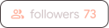
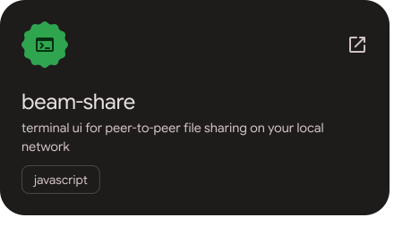
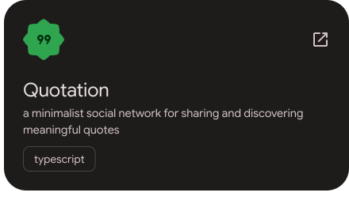
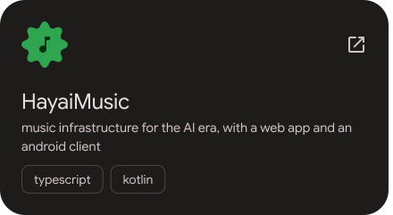
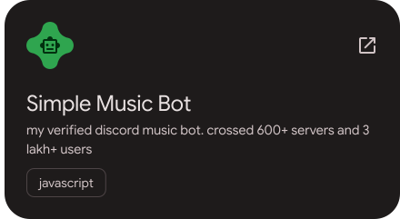

<!-- Hero, project cards and footer are styled after sc.is-a.dev (Material 3 Expressive). Images live in assets/m3. -->

<a href="https://sc.is-a.dev"><picture><source media="(prefers-color-scheme: dark)" srcset="assets/m3/hero-dark.svg"><source media="(prefers-color-scheme: light)" srcset="assets/m3/hero-light.svg"></picture></a>

  <a href="https://sc.is-a.dev"><picture><source media="(prefers-color-scheme: dark)" srcset="assets/m3/btn-profile-dark.svg"><source media="(prefers-color-scheme: light)" srcset="assets/m3/btn-profile-light.svg"></picture></a>
  <a href="https://swar.is-a.dev"><picture><source media="(prefers-color-scheme: dark)" srcset="assets/m3/btn-portfolio-dark.svg"><source media="(prefers-color-scheme: light)" srcset="assets/m3/btn-portfolio-light.svg"></picture></a>
  <a href="https://sc.is-a.dev/hackathons/"><picture><source media="(prefers-color-scheme: dark)" srcset="assets/m3/btn-hackathons-dark.svg"><source media="(prefers-color-scheme: light)" srcset="assets/m3/btn-hackathons-light.svg"></picture></a>
  <a href="https://discord.com/users/594504468931018752"><picture><source media="(prefers-color-scheme: dark)" srcset="assets/m3/btn-discord-dark.svg"><source media="(prefers-color-scheme: light)" srcset="assets/m3/btn-discord-light.svg"></picture></a>

  <!-- Numbers are drawn into these images; .github/workflows/counters.yml redraws them every 8 hours. -->
  <picture><source media="(prefers-color-scheme: dark)" srcset="assets/m3/stat-visitors-dark.svg"><source media="(prefers-color-scheme: light)" srcset="assets/m3/stat-visitors-light.svg"></picture>
  <a href="https://discord.gg/UVWjuAh"><picture><source media="(prefers-color-scheme: dark)" srcset="assets/m3/stat-discord-dark.svg"><source media="(prefers-color-scheme: light)" srcset="assets/m3/stat-discord-light.svg"></picture></a>
  <a href="https://github.com/SC136?tab=followers"><picture><source media="(prefers-color-scheme: dark)" srcset="assets/m3/stat-followers-dark.svg"><source media="(prefers-color-scheme: light)" srcset="assets/m3/stat-followers-light.svg"></picture></a>
  <!-- 1px: loading this is what makes the visitor counter count. The chip above shows its number. -->
  

<picture><source media="(prefers-color-scheme: dark)" srcset="assets/m3/head-projects-dark.svg"><source media="(prefers-color-scheme: light)" srcset="assets/m3/head-projects-light.svg"></picture>

<a href="https://github.com/SC136/beam-share"><picture><source media="(prefers-color-scheme: dark)" srcset="assets/m3/proj-1-dark.svg"><source media="(prefers-color-scheme: light)" srcset="assets/m3/proj-1-light.svg"></picture></a><a href="https://www.quotation.social"><picture><source media="(prefers-color-scheme: dark)" srcset="assets/m3/proj-2-dark.svg"><source media="(prefers-color-scheme: light)" srcset="assets/m3/proj-2-light.svg"></picture></a> 
<a href="https://music.hayai.tech"><picture><source media="(prefers-color-scheme: dark)" srcset="assets/m3/proj-3-dark.svg"><source media="(prefers-color-scheme: light)" srcset="assets/m3/proj-3-light.svg"></picture></a><a href="https://github.com/SC136/Simple-Music-Bot"><picture><source media="(prefers-color-scheme: dark)" srcset="assets/m3/proj-4-dark.svg"><source media="(prefers-color-scheme: light)" srcset="assets/m3/proj-4-light.svg"></picture></a>

<picture><source media="(prefers-color-scheme: dark)" srcset="assets/m3/head-stack-dark.svg"><source media="(prefers-color-scheme: light)" srcset="assets/m3/head-stack-light.svg"></picture>

  

  <picture><source media="(prefers-color-scheme: dark)" srcset="assets/m3/setup-dark.svg"><source media="(prefers-color-scheme: light)" srcset="assets/m3/setup-light.svg"></picture>

<picture><source media="(prefers-color-scheme: dark)" srcset="assets/m3/head-lately-dark.svg"><source media="(prefers-color-scheme: light)" srcset="assets/m3/head-lately-light.svg"></picture>

  
  

<picture><source media="(prefers-color-scheme: dark)" srcset="assets/m3/head-stats-dark.svg"><source media="(prefers-color-scheme: light)" srcset="assets/m3/head-stats-light.svg"></picture>

  

<picture><source media="(prefers-color-scheme: dark)" srcset="assets/m3/head-hangout-dark.svg"><source media="(prefers-color-scheme: light)" srcset="assets/m3/head-hangout-light.svg"></picture>

Anime, programming, memes, gaming.

  

<a href="https://sc.is-a.dev"><picture><source media="(prefers-color-scheme: dark)" srcset="assets/m3/footer-dark.svg"><source media="(prefers-color-scheme: light)" srcset="assets/m3/footer-light.svg"></picture></a>

